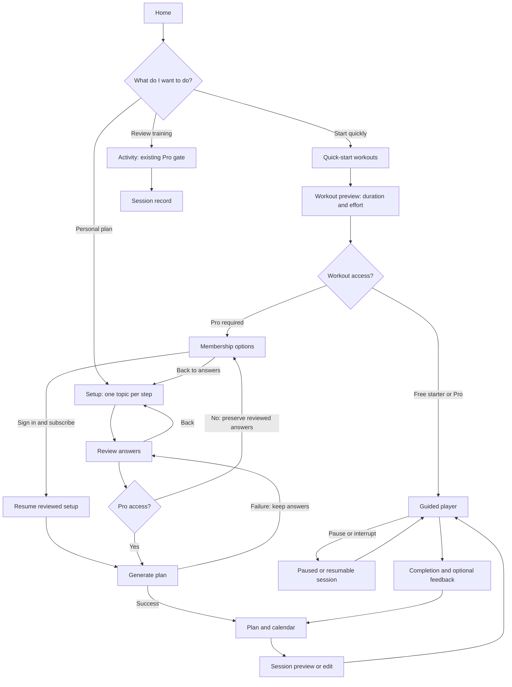

# Axyro UX review — 21 October 2026

## Scope and source principles

This pass improves existing task completion, navigation, keyboard use, and
recovery. It preserves the visual identity, 40-exercise catalog, timing model,
recovery days, and membership rules.

- [WeWeb web app design guide](https://www.weweb.io/blog/web-app-design-guide-process-checklist): organize around user tasks and verify loading, empty, error, and success states. Applied to search recovery, setup, and route failures.
- [David Holden's user-flow walkthrough](https://uxdholden.medium.com/7-user-flow-diagram-for-ux-1a57c6290424): map the main journey with decisions, screen states, and return paths. Applied to the flow below, including access checks and returning to answers.
- [UX Pilot checklist](https://uxpilot.ai/blogs/website-user-experience-checklist): make navigation, actions, forms, touch targets, and accessibility clear. Applied through direct Activity navigation, keyboard bypass, step focus, and responsive checks.

These articles are heuristic inputs, not evidence that Axyro's users need every
suggested feature. No conversion uplift, universal three-click rule, fabricated
social proof, or accessibility certification is claimed.

## Core user flow

## Findings and changes

| Finding | User impact | Applied change |
| --- | --- | --- |
| Clearing a search left the old input draft active | The old query reapplied itself, trapping users in empty results | Synchronize input on URL changes; add Reset filters; reset pagination on filter changes |
| Result updates only showed a temporary loading message | Assistive technology did not receive the final result count | Announce result count with a status region |
| Activity was only reachable through Home/Plan links | Reviewing completed training was less discoverable | Add Activity to the primary navigation; retain existing authorization |
| No keyboard bypass for shared navigation | Repeated tabbing before reaching page content | Add a focus-visible skip link and focusable content target |
| Setup changed content without moving focus | Keyboard users could remain at the bottom of the previous step | Focus the new step heading and return to the top on forward/back navigation |
| No app-specific not-found or route-error UI | Broken links and render errors had no contextual recovery | Add workout/home exits and route retry using this installed Next.js version's `retry` API |

## Existing UX retained

The app already provides a guest starter, explicit Pro messaging, selected-state
controls, labeled forms, password visibility controls, account loading/retry
states, persistent workout continuation, focus-trapped guidance dialogs,
reduced-motion styles, and completion feedback. These mechanisms are retained;
this pass does not replace them with additional onboarding or modal prompts.

## Verification and limits

Regression coverage is in `tests/e2e/ux-flows.spec.ts`; the existing navigation
smoke test now checks five destinations. The error-screen unit test checks that
retry invokes the supplied callback and that the home exit is available.
Validation completed: 327 unit tests and 23 selected browser checks passed,
along with TypeScript and the production build. Changed files pass ESLint; the
repository-wide lint run reports 188 warnings in bundled skill scripts and no
errors.

Browser checks use isolated Chromium with mobile emulation and 320px, 768px,
and 1280px viewports. Automated axe checks supplement keyboard and flow checks.

This is not a physical-device test, a full screen-reader audit, or a usability
study with athletes. Live payment-provider success, production performance,
offline relaunch, and recovery of unsaved state after a render crash require
separate validation. The root route error boundary does not catch errors in the
root layout/providers. No analytics, notifications, or new tracking were added.
